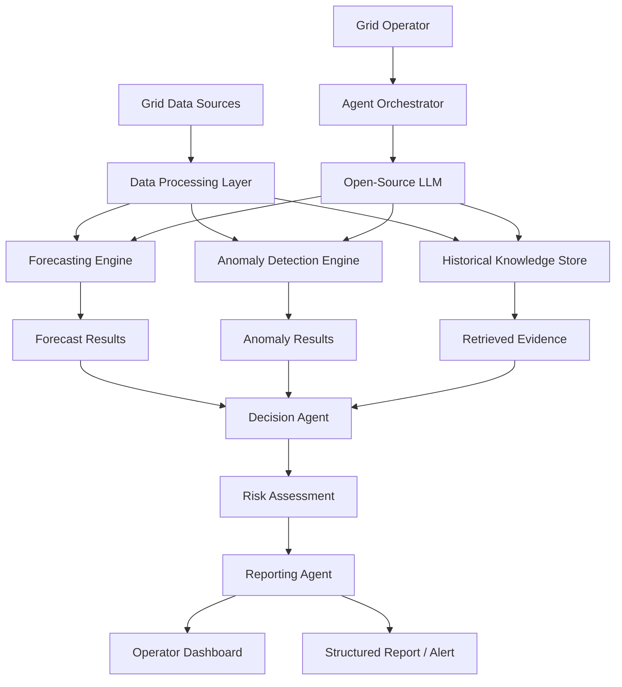
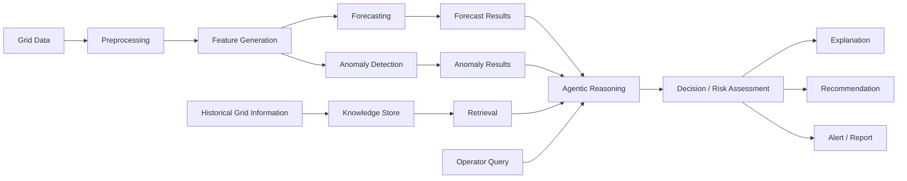
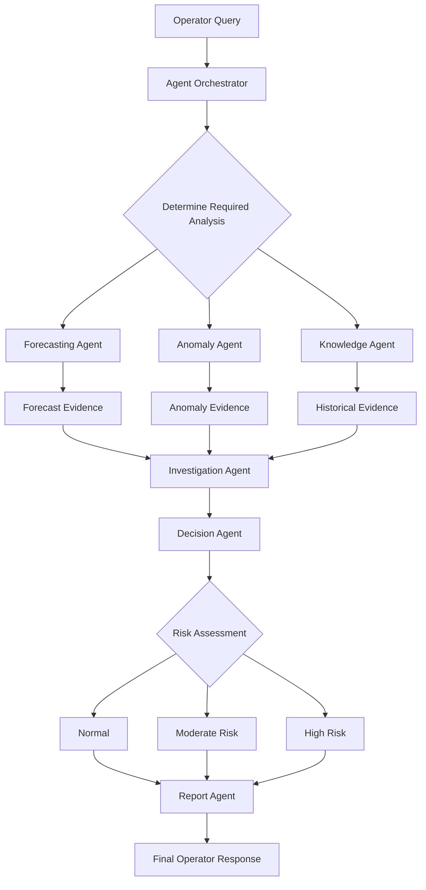

# GridMind — Agentic Smart Grid Intelligence

> **Hacktoberfest Hack Day — Open Source AI Hackathon**
> **Problem Statement:** 1 — Best Open-Source AI Project
> **Team Name:** `Technomats"
---

## 1. Project Name

# GridMind — Agentic Smart Grid Intelligence

**GridMind** is an agentic AI system designed to help electricity-grid operators monitor grid conditions, forecast electricity demand, detect abnormal patterns, investigate potential causes, and generate actionable insights using open-source AI and machine-learning components.

---

## 2. Problem Statement

Modern electricity grids generate large volumes of operational data from sources such as SCADA systems, smart meters, weather information, and historical grid records.

Although forecasting and anomaly-detection models can identify patterns, grid operators still need to manually interpret these outputs and connect information from multiple sources to understand:

- Why an unusual load pattern occurred.
- Whether an upcoming demand peak presents a risk.
- Whether the observed behavior is normal or anomalous.
- What historical situations are similar.
- What operational factors may have contributed to the event.

The problem is therefore not only **predicting electricity demand**, but also **turning multiple analytical outputs into understandable and actionable grid intelligence**.

---

## 3. Project Overview

GridMind combines conventional machine-learning models with an **agentic AI architecture**.

The system continuously processes electricity-grid information and allows an operator to ask natural-language questions such as:

> "Why is tomorrow's expected peak demand unusually high?"

GridMind coordinates specialized agents that can:

1. Retrieve relevant grid information.
2. Forecast future electricity demand.
3. Detect unusual load patterns.
4. Investigate historical and contextual information.
5. Assess the severity of the situation.
6. Generate an understandable explanation.
7. Provide recommended actions or monitoring priorities.

The objective is to create an **AI-powered decision-support layer for grid intelligence**, rather than a generic chatbot.

---

## 4. Proposed Solution

GridMind uses a multi-agent architecture in which each agent has a clearly defined responsibility.

### Core Agents

| Agent                   | Responsibility                                               |
| ----------------------- | ------------------------------------------------------------ |
| Forecasting Agent       | Generates short-term electricity-load forecasts              |
| Anomaly Detection Agent | Identifies unusual load behavior                             |
| Investigation Agent     | Investigates possible causes of abnormal patterns            |
| Knowledge Agent         | Retrieves relevant historical and contextual information     |
| Decision Agent          | Combines evidence and assesses risk                          |
| Reporting Agent         | Converts analytical results into an operator-friendly report |

The agents are coordinated through an **agent orchestration layer**.

The open-source LLM acts as the reasoning layer that interprets the outputs of analytical tools and determines which tools or agents should be used for a particular query.

---

## 5. Objectives

The primary objectives of GridMind are:

- Build an intelligent decision-support system for electricity-grid monitoring.
- Combine time-series forecasting with agentic AI.
- Detect abnormal electricity-load patterns.
- Provide explanations for detected anomalies and unusual forecasts.
- Retrieve and use historical grid information during analysis.
- Provide risk assessments and recommended operational priorities.
- Demonstrate meaningful use of open-source AI.
- Create an architecture that can be extended with additional grid-data sources and analytical models.

---

## 6. Target Users / Use Case

### Target Users

The primary target users are:

- Electricity-grid operators.
- Load dispatch center personnel.
- Energy analysts.
- Power-system engineers.
- Grid monitoring teams.

### Example Use Case

An operator asks:

> **"Analyze tomorrow's peak-load risk."**

GridMind can:

1. Generate the expected load profile.
2. Identify the expected peak period.
3. Compare the forecast against historical patterns.
4. Detect whether the forecast represents an unusual condition.
5. Retrieve similar historical situations.
6. Assess the risk.
7. Generate a concise explanation and recommended monitoring priorities.

---

## 7. Open-Source AI Technology Selected

GridMind will use an **open-source/open-weight Large Language Model (LLM)** as its primary reasoning component.

The model family will be selected based on final deployment constraints, model capability, inference efficiency, and licensing suitability. Candidate models include:

- Qwen
- Llama
- Gemma
- Other appropriately licensed open models

### Supporting open-source technologies

- **LangGraph** — agent orchestration
- **PyTorch / TensorFlow** — machine-learning models
- **scikit-learn** — anomaly detection and supporting ML
- **FAISS / Qdrant** — retrieval layer
- **FastAPI** — backend API
- **Python** — core implementation

---

## 8. Why This Technology Was Selected

An open-source/open-weight LLM is selected because GridMind requires more than simple text generation.

The reasoning model needs to:

- Understand natural-language questions from operators.
- Decide which analytical tools are relevant.
- Interpret outputs from forecasting and anomaly-detection models.
- Combine evidence from multiple sources.
- Explain analytical results in understandable language.
- Produce structured responses.

An open-source approach also provides greater flexibility for:

- Local inference.
- Model selection.
- Quantization.
- Customization.
- Integration with domain-specific tools.
- Reducing dependence on proprietary AI APIs.

The LLM is therefore not an optional chatbot component; it forms the **reasoning and orchestration layer of the system**.

---

## 9. AI's Role in the System

AI is central to GridMind.

The system contains multiple AI capabilities:

### 1. Predictive AI

Time-series forecasting models predict future electricity demand.

### 2. Anomaly Detection

Machine-learning and statistical techniques identify deviations from expected grid behavior.

### 3. Retrieval

The system retrieves relevant historical and contextual information.

### 4. Agentic Reasoning

The open-source LLM determines how different analytical capabilities should be combined to answer an operator's query.

### 5. Decision Support

The system synthesizes evidence into:

- Risk assessment.
- Explanation.
- Recommended monitoring priorities.

Therefore, AI directly contributes to the core functionality rather than being an optional interface.

---

## 10. System Architecture



### Architecture Layers

**Data Layer**

Handles grid measurements, historical records, and contextual information.

**Analytics Layer**

Contains forecasting and anomaly-detection models.

**Knowledge Layer**

Stores historical information and enables retrieval of relevant records.

**Agentic Layer**

Coordinates specialized agents and analytical tools.

**Reasoning Layer**

Uses the selected open-source LLM to interpret information and coordinate the workflow.

**Application Layer**

Provides the operator dashboard, explanations, reports, and alerts.

---

## 11. Component-Level Architecture

| Component                | Purpose                                    |
| ------------------------ | ------------------------------------------ |
| Data Ingestion           | Receives and prepares grid information     |
| Data Preprocessor        | Cleaning, normalization and transformation |
| Forecasting Engine       | Predicts future electricity demand         |
| Anomaly Detection Engine | Detects unusual load patterns              |
| Knowledge Store          | Stores historical/contextual information   |
| Retrieval Engine         | Finds relevant historical information      |
| Agent Orchestrator       | Coordinates agents and tools               |
| Open-Source LLM          | Reasoning and interpretation               |
| Decision Engine          | Combines evidence and evaluates risk       |
| Reporting Engine         | Generates explanations and reports         |
| Backend API              | Connects AI services to the interface      |
| Dashboard                | Provides operator interaction              |

---

## 12. Data / Information Flow



### Example Information Flow

```text
Operator Query
      ↓
"Why is tomorrow's peak demand high?"
      ↓
Agent Orchestrator
      ↓
Forecasting Agent
      ↓
Forecast Results
      ↓
Anomaly Agent
      ↓
Historical Knowledge Retrieval
      ↓
Investigation Agent
      ↓
Decision Agent
      ↓
Risk Assessment
      ↓
Explanation + Recommendation
```

---

## 13. Agentic Workflow

GridMind follows a tool-using agentic workflow.



### Example

For:

> "Is tomorrow's evening peak likely to create an abnormal condition?"

The system may execute:

1. Forecast future load.
2. Compare the forecast against historical patterns.
3. Detect abnormal deviations.
4. Retrieve similar historical periods.
5. Analyze the evidence.
6. Assign a risk level.
7. Generate an explanation.

The system does not require every query to execute every component. The agentic layer selects the appropriate tools based on the task.

---

## 14. Technology Stack

| Layer           | Technology                            |
| --------------- | ------------------------------------- |
| Programming     | Python                                |
| LLM             | Open-source/Open-weight LLM           |
| Agent Framework | LangGraph                             |
| Deep Learning   | PyTorch / TensorFlow                  |
| Forecasting     | LSTM / TCN / Transformer-based models |
| ML              | scikit-learn                          |
| Retrieval       | FAISS / Qdrant                        |
| Backend         | FastAPI                               |
| Frontend        | Streamlit or Web Interface            |
| Data Processing | Pandas, NumPy                         |
| Visualization   | Matplotlib / Plotly                   |
| Version Control | Git + GitHub                          |

The exact open-source LLM and supporting components will be finalized according to available compute resources and final implementation requirements.

---

## 15. Expected Features

### Core Features

- Electricity-load forecasting.
- Anomaly detection.
- Historical-event retrieval.
- Natural-language operator queries.
- Multi-agent analysis.
- Automated risk assessment.
- Explainable analytical results.
- Recommended monitoring priorities.
- Structured reports.
- Interactive dashboard.

### Example Dashboard

The dashboard can display:

- Current load.
- Forecasted load.
- Expected peak.
- Detected anomalies.
- Risk level.
- Historical comparison.
- AI-generated explanation.
- Recommended action.

---

## 16. Implementation Approach

The final implementation will be developed incrementally.

### Phase 1 — Data Preparation

- Load historical electricity data.
- Clean and preprocess data.
- Create required time-series features.
- Prepare historical information for retrieval.

### Phase 2 — Analytical Models

Implement:

- Load forecasting model.
- Anomaly detection model.
- Historical comparison mechanisms.

### Phase 3 — Knowledge Retrieval

Create a searchable knowledge layer containing relevant historical grid information.

### Phase 4 — Agentic Layer

Implement specialized agents using LangGraph.

Each agent will have clearly defined tools and responsibilities.

### Phase 5 — Open-Source LLM Integration

Integrate the selected open-source model as the reasoning layer.

The model will interpret user queries, select appropriate tools, and synthesize their outputs.

### Phase 6 — Application

Develop an interface through which users can:

- Ask questions.
- View forecasts.
- Inspect anomalies.
- Review explanations.
- View risk assessments.

### Phase 7 — Evaluation

Evaluate:

- Forecasting performance.
- Anomaly-detection performance.
- Classification/risk consistency.
- Agent workflow reliability.
- Response quality.
- Inference latency.

---

## 17. Expected Final Output

For an operator query such as:

> **"Analyze tomorrow's peak-load risk."**

The system is expected to produce an output similar to:

```text
GRIDMIND ANALYSIS

Expected Peak: 8,420 MW
Expected Peak Time: 18:30
Historical Deviation: +8.7%
Risk Level: HIGH

Key Factors:
• Forecast exceeds recent historical pattern.
• Similar historical periods showed elevated evening demand.
• An abnormal increase was detected in the recent load pattern.

Recommended Monitoring:
• Closely monitor demand between 17:30–20:00.
• Monitor relevant grid conditions during the predicted peak.
• Review reserve capacity for the expected high-demand period.

Confidence: 0.89
```

The exact values shown above are illustrative. The final system will generate values from the available data.

---

## 18. Future Scope / Scalability

GridMind can be extended beyond load forecasting.

### Future extensions

- Renewable-energy forecasting.
- Solar and wind generation analysis.
- Weather-aware grid intelligence.
- Transformer/feeder anomaly detection.
- Predictive maintenance.
- Electricity-price forecasting.
- Grid-event summarization.
- Voice-based operator interaction.
- Automated incident reports.
- Integration with additional real-time grid data sources.

### Scalability

The architecture is modular, allowing additional:

- Agents.
- Models.
- Data sources.
- Tools.
- Knowledge bases.

to be integrated without redesigning the complete system.

---

## 19. Open-Source Dependencies / Components

| Component                   | Role                               |
| --------------------------- | ---------------------------------- |
| Open-source/Open-weight LLM | Reasoning and agentic intelligence |
| LangGraph                   | Agent workflow orchestration       |
| PyTorch / TensorFlow        | Deep-learning models               |
| scikit-learn                | ML and anomaly detection           |
| FAISS / Qdrant              | Knowledge retrieval                |
| Pandas                      | Data processing                    |
| NumPy                       | Numerical computation              |
| FastAPI                     | Backend services                   |
| Streamlit / Web UI          | User interface                     |
| GitHub                      | Open-source project hosting        |

All dependencies will be selected according to their applicable licenses and compatibility with the final project.

---

## 20. Expected Challenges and Mitigation

| Challenge                           | Mitigation                                                                  |
| ----------------------------------- | --------------------------------------------------------------------------- |
| Forecasting errors                  | Compare multiple forecasting approaches and evaluate using standard metrics |
| False anomaly detection             | Combine statistical and ML-based detection                                  |
| LLM hallucination                   | Ground responses in tool outputs and retrieved evidence                     |
| Incorrect agent decisions           | Use constrained tool interfaces and structured outputs                      |
| Limited computational resources     | Use efficient/quantized open models where appropriate                       |
| Retrieval of irrelevant information | Improve document structure, metadata and retrieval strategy                 |
| Agent workflow failures             | Add validation and fallback mechanisms                                      |
| High inference latency              | Optimize model size, retrieval and tool execution                           |
| Ambiguous operator queries          | Use structured query interpretation and clarification                       |
| Data quality issues                 | Apply preprocessing and validation before analysis                          |

---

# Conclusion

**GridMind — Agentic Smart Grid Intelligence** proposes an AI-powered decision-support system that combines electricity-load forecasting, anomaly detection, knowledge retrieval, and agentic reasoning.

The project goes beyond a conventional chatbot by giving the open-source AI system access to specialized analytical tools and requiring it to **reason over real analytical evidence** before producing an explanation or recommendation.

The proposed architecture is modular, scalable, and designed to demonstrate meaningful engineering and practical use of open-source AI in the electricity-grid domain.

> **GridMind: From Grid Data to Intelligent Decisions.**
